## Hello there 👋

I'm Rafał, an **ML Engineer** and **PhD student** at the Silesian University of Technology, working on **quantum computing for cosmology**.

### ⚛️🌌🔬 Research

- 🖼️ **Quantum image encoding**: a general model that unifies quantum image representations such as FRQI and NEQR
- 🌌 **Cosmic Web on quantum computers**: encoding and retrieving dark-matter density snapshots from cosmological simulations
- 🧠 **Quantum machine learning**: quantum and hybrid neural networks for image classification

### 📊📈🐙 GitHub stats

### 📜📚✍️ Publications

- **R. Potempa**, M. Kordasz, J. P. Cyran, K. Wereszczyński, K. Simiński, *GEQIE Framework for Rapid Quantum Image Encoding*, arXiv (2025). [arXiv:2512.24973](https://arxiv.org/abs/2512.24973)
- M. Kordasz, K. Werner, S. N. Khan, **R. Potempa**, K. Wereszczyński, K. A. Cyran, *Quantum Image Encoding and Processing: A Comparative Analysis of Quantum Computing Systems*, CoDIT (2025). [DOI](https://doi.org/10.1109/codit66093.2025.11321343)
- K. Werner, K. Wereszczyński, A. Michalczuk, M. Kordasz, **R. Potempa**, K. A. Cyran, *Error Reduction for Image Encoding-Reconstruction for Quantum Photonic Systems*, CoDIT (2025). [DOI](https://doi.org/10.1109/codit66093.2025.11321676)
- **R. Potempa**, O. Nwobodo, K. Wereszczyński, K. Cyran, *General Quantum Image Representation Model and Framework*, ICCS (2024).
- K. Werner, K. Wereszczyński, **R. Potempa**, K. A. Cyran, *Deep Learning as a Tool of Quantum Error Reduction in Quantum Image Processing*, preprint (2023). [DOI](https://doi.org/10.20944/preprints202310.0073.v1)
- **R. Potempa**, S. Porębski, *Comparing Concepts of Quantum and Classical Neural Network Models for Image Classification Task*, Progress in Image Processing, Pattern Recognition and Communication Systems (2021). [DOI](https://doi.org/10.1007/978-3-030-81523-3_6)
